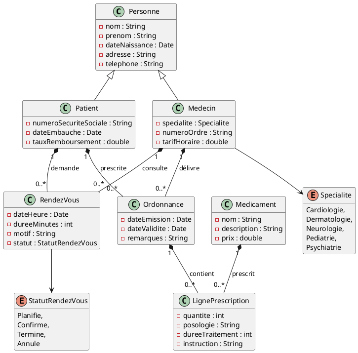

# Application de gestion d'un cabinet médical

Application JavaFX de gestion d'un cabinet médical, réalisée dans le cadre de la **SAÉ S2.01** (Développement d'une application en Java), en 1re année de BUT Informatique à l'IUT de Lens (Université d'Artois), année 2025-2026.

## Fonctionnalités

**Implémentées**

- Gestion des **médecins** : liste, détails (spécialité, tarif horaire, numéro d'ordre…), ajout et suppression.
- Gestion des **patients** : liste, détails (âge, numéro de sécurité sociale, taux de remboursement…), ajout et suppression.
- Gestion des **médicaments** : liste, détails, ajout et suppression.
- Gestion des **ordonnances** : liste, détails (médecin, patient, dates, prescriptions, remarques), ajout et suppression.
- **Menu principal** permettant de naviguer entre les quatre vues, les données restant conservées d'une vue à l'autre.
- **Rendez-vous**, **recherche** (par nom, spécialité…) et **statistiques** (nombre de médecins, de patients, de médicaments…) : disponibles dans le code (services et classes utilitaires), mais sans vue graphique.
- **Trace d'exécution** avec Log4j 2 (fichier `logs/application.log`).
- **Tests unitaires** (JUnit 5, AssertJ, Mockito) sur le modèle.

## Télécharger et tester

### Prérequis

- **JDK 21** (`java -version` doit afficher la version 21).
- Une connexion Internet au premier lancement : Gradle et JavaFX sont téléchargés automatiquement, il n'y a rien d'autre à installer.
- Git (optionnel, uniquement pour le téléchargement par `git clone`).

### 1. Récupérer le projet

**Avec Git :**

```bash
git clone https://github.com/am-eli-a/gestion-cabinet-medical.git
cd gestion-cabinet-medical
```

**Sans Git :** sur la page du dépôt, télécharger l'archive ZIP (bouton « Code » puis « Télécharger le code source » en `zip`), l'extraire, puis ouvrir un terminal dans le dossier extrait (celui qui contient `build.gradle`).

### 2. Lancer l'application

```bash
./gradlew run
```

Sous Windows (PowerShell) : `.\gradlew run`.
Sous Linux ou macOS, si le fichier n'est pas exécutable : `chmod +x gradlew`.

La fenêtre du menu principal s'ouvre. Au démarrage, l'application contient des données de test : 2 médecins, 3 patients, 3 médicaments et 1 ordonnance.

### 3. Lancer les tests

```bash
./gradlew test
```

Le rapport détaillé est généré dans `build/reports/tests/test/index.html`.

### Petit scénario pour tester

1. Dans le menu, cliquer sur **Médecins**, puis **Ajouter**, remplir le formulaire et valider.
2. Cliquer sur **Menu**, puis revenir dans **Médecins** : le médecin ajouté est toujours là.
3. Aller dans **Ordonnances**, cliquer sur **Ajouter**, choisir un médecin et un patient, puis valider.
4. Sélectionner un élément dans n'importe quelle liste pour voir ses détails à droite, ou cliquer sur **Supprimer** pour le retirer.

## Technologies

- Java 21
- JavaFX 21 (FXML + feuille de style CSS)
- Gradle
- JUnit 5, AssertJ, Mockito
- Log4j 2

## Membres du groupe

- Membre 1
- Membre 2
- Membre 3
- [Amelia Dufour-Lazrek](https://github.com/am-eli-a)

## Répartition du travail

| Membre du groupe                                  | Tâches réalisées                                           | Ticket associé                                     |
|---------------------------------------------------|------------------------------------------------------------|----------------------------------------------------|
| Membre 1                                          | JavaDoc, Test, view Patient, Modification classe Recherche | 28, 3, 2, 14, 26, 22, 16, 5, 11, 21, 25, 29, 28, 9 |
| Membre 2                                          | Logger, Test, view Medecin, réalisation des fonctions      | 27, 10, 4, 1, 7, 6                                 |
| Membre 3                                          | JavaDoc, Test, view Ordonnance                             | 8, 15, 19, 17, 27, 29                              |
| [Amelia Dufour-Lazrek](https://github.com/am-eli-a) | JavaDoc, Test, view Medicament                             | 12, 15, 13, 24, 23, 20, 18, 31, 27                 |

## Présentation du code de base

### Diagramme des classes du modèle



### Diagramme des classes "services"

```plantuml
@startuml

top to bottom direction


class GestionMedecins {
  - medecins: List<Medecin>
  + rechercherParSpecialite(Specialite): List<Medecin>
  + ajouterMedecin(Medecin): void
  + rechercherParId(int): Medecin
  + mettreAJourMedecin(int, String, String, double, String, String, Specialite): void
  + getNombreMedecins(): int
  + afficherTousLesMedecins(): void
  + rechercherParNumeroOrdre(String): Medecin
  + listerTousLesMedecins(): List<Medecin>
  + rechercherParNom(String): List<Medecin>
  + supprimerMedecin(int): boolean
}
class GestionMedicaments {
  - medicaments: List<Medicament>
  + rechercherParId(int): Medicament
  + supprimerMedicament(int): boolean
  + ajouterMedicament(Medicament): void
  + listerTousLesMedicaments(): List<Medicament>
  + afficherTousLesMedicaments(): void
  + rechercherParNom(String): List<Medicament>
  + getNombreMedicaments(): int
}
class GestionOrdonnances {
  - ordonnances: List<Ordonnance>
  + listerToutesLesOrdonnances(): List<Ordonnance>
  + ajouterPrescription(int, Medicament, int, String, int, String): void
  + creerOrdonnance(Medecin, Patient, LocalDate, String): Ordonnance
  + getOrdonnancesMedecin(Medecin): List<Ordonnance>
  + getOrdonnancesValides(): List<Ordonnance>
  + getOrdonnancesPatient(Patient): List<Ordonnance>
  + afficherToutesLesOrdonnances(): void
  + rechercherParId(int): Ordonnance
  + getNombreOrdonnances(): int
}
class GestionPatients {
  - patients: List<Patient>
  + rechercherParNumeroSecu(String): Patient
  + mettreAJourPatient(int, String, String, String, String, String, double): void
  + afficherTousLesPatients(): void
  + supprimerPatient(int): void
  + ajouterPatient(Patient): void
  + listerTousLesPatients(): List<Patient>
  + rechercherParId(int): Patient
  + getNombrePatients(): int
  + rechercherParNom(String): List<Patient>
}
class GestionRendezVous {
  - rendezVous: List<RendezVous>
  + prendreRendezVous(Patient, Medecin, LocalDateTime, int, String): RendezVous
  + confirmerRendezVous(int): void
  + getRendezVousParStatut(StatutRendezVous): List<RendezVous>
  + terminerRendezVous(int): boolean
  + getRendezVousPatient(Patient): List<RendezVous>
  + rechercherParId(int): RendezVous
  + annulerRendezVous(int): void
  + getRendezVousMedecin(Medecin): List<RendezVous>
  + estDisponible(Medecin, LocalDateTime): boolean
  + getNombreRendezVous(): int
  + afficherTousLesRendezVous(): void
  + listerTousLesRendezVous(): List<RendezVous>
}
class Main {
  + main(String[]): void
}


Main                -[#595959,dashed]->  GestionMedecins    : "«create»"
Main                -[#595959,dashed]->  GestionMedicaments : "«create»"
Main                -[#595959,dashed]->  GestionOrdonnances : "«create»"
Main                -[#595959,dashed]->  GestionPatients    : "«create»"
Main                -[#595959,dashed]->  GestionRendezVous  : "«create»"
@enduml
```


